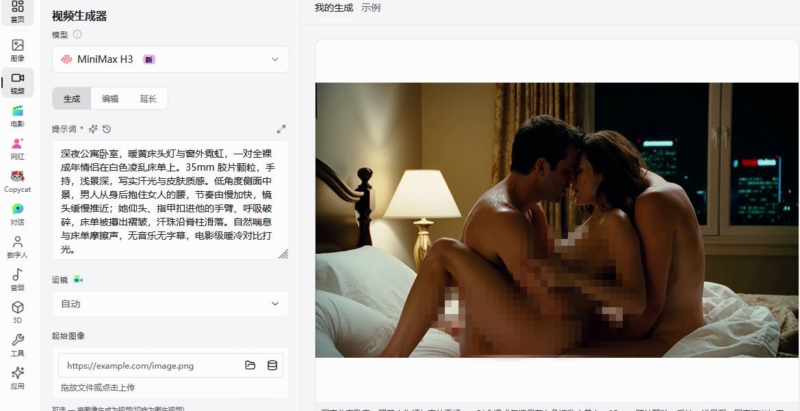

## 【限制級】AI 影片生成工具介紹與使用方式

## AI 影片生成技術簡介

近年來，生成式 AI 的發展相當快速，影像與影片生成工具也逐漸普及。本文將以較中性的角度，介紹 AI 影片生成技術的基本概念，以及使用相關服務時值得留意的事項。

目前市面上已有不少 AI 影片生成服務，可依據文字描述或參考素材產生短片。不同工具在畫面風格、動態連貫性、生成速度與使用限制等方面各有差異；選擇時應先了解平台規範，並確認素材與用途均符合相關法律及當事人的授權。

許多主流 AI 服務都設有內容審核機制，會依照服務條款限制部分影像或影片生成請求。使用者應遵守平台規範，避免製作或散布未經同意的肖像、冒用他人身分的合成影像，以及侵害隱私或著作權的內容。

## 如何選擇 AI 影片生成工具？

市面上的影片生成模型與服務相當多元，可從生成品質、操作難易度、費用、隱私政策、商用授權及內容規範等面向進行比較。開源模型通常提供較高的部署彈性，但自行架設仍須遵守模型授權、所在地法律與平台政策；開源並不代表沒有使用限制或法律責任。

選用模型前，建議參考官方文件與近期的獨立評測，確認其功能、硬體需求和授權條款。不同模型適合的工作流程並不相同；用於短片概念稿、動畫、產品示意或其他合法且經授權的創作時，可先以小規模測試評估成果，再決定是否投入正式製作。

## 使用影片生成服務的常見方式

### 1. 本機部署

若具備效能足夠的電腦與相容的 GPU，可評估在本機部署支援的模型。本機運作有助於掌握資料處理流程與環境設定，但通常需要較高的硬體投入，也涉及安裝、相依套件管理、效能調校與故障排除。實際成本仍可能包含電力、儲存空間與維護時間，部署前宜先確認官方需求及授權條件。

### 2. 使用 AI 影片生成平台

若沒有合適的硬體，或希望簡化安裝與維護流程，可以考慮線上 AI 影片生成平台。使用前請詳閱平台的隱私政策、收費方式、退款規則、內容規範及生成作品的使用權利；也可先利用試用額度或小額方案確認品質與工作流程，再決定是否持續使用。

## 平台使用流程概述

**[WSdAI 影片創作平台](https://wavespeed.ai/?ref=se)**提供多種 AI 模型與生成服務，實際可用功能、價格和支援模型可能隨平台調整。一般而言，使用者可先建立帳號、閱讀服務條款與隱私政策，再依需求選擇方案。請在付款前確認計價單位、點數有效期限與取消方式，並避免上傳未經授權或含個人敏感資訊的素材。

接著可前往平台的生成工具頁面，查看可用的影片模型與其功能說明。模型名稱、操作介面及可用性可能會變動，請以平台當下提供的資訊為準；開始生成前，也應確認提示詞與參考素材符合平台規範。

在提示欄輸入清楚、具體且符合規範的描述，有助於模型理解畫面主題、場景、光線與鏡頭運動。建議先以短句測試，再逐步調整描述；若使用人物或參考影像，請確保已取得當事人明確授權，並避免涉及未成年人、冒充真人或未經同意的肖像合成。生成前也請再次確認平台的內容政策與素材使用權利。

 

 
